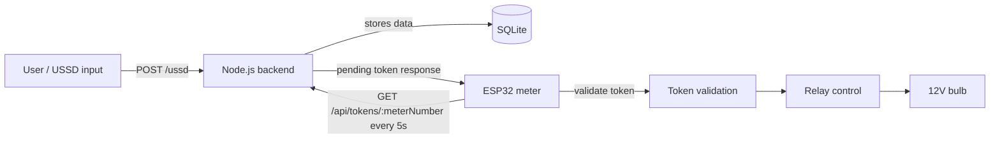

# IoT-based automated prepaid electricity token entry (USSD + Node.js backend + ESP32)

This project automates prepaid electricity token entry using a USSD flow, a Node.js backend, and an ESP32 meter that polls for pending tokens over HTTP and switches a relay-driven bulb.

## Problem

Prepaid electricity tokens are still often handled manually. This prototype attempts to reduce that friction by letting a user start a USSD-style flow, saving the generated token in a database, and allowing an ESP32 meter to fetch and apply it without manual entry.

TODO (Solomon to confirm): exact utility partner, deployment context, and intended production workflow.

## How it works

The flow in this repository is: user/USSD input -> Node.js backend -> SQLite -> ESP32 polls the backend over HTTP -> token validation -> relay/bulb control.



## Features

- USSD-style flow implemented in the browser simulation and Node.js `/ussd` route.
- SQLite transaction storage for phone number, meter number, token, amount, and status.
- ESP32 polling of the backend for pending tokens over HTTP.
- Token activation and use-state updates through backend endpoints.
- Relay-driven control of a bulb and persistence of token state in ESP32 flash memory.
- Manual Serial testing mode in the ESP32 firmware for token validation without a live server.

## Tech stack

| Layer | Technology |
| --- | --- |
| Meter/control | ESP32 |
| Backend | Node.js |
| Database | SQLite |
| Interface | REST API |
| User flow | Africa's Talking USSD |
| Device polling | HTTP polling |

## Repository structure

- `ESP32/`: contains the ESP32 firmware and helper files, including `sketch_mar16a.ino`, `yaka_backend.py`, `yaka.db`, and IDE metadata.
- `UEDCL-ARTIFACT/`: contains the backend service and SQLite database used by the project, including `server.js`, `database.sqlite`, `package.json`, and `package-lock.json`.
- `USSD-SIMULATED-UI/`: contains the browser-based simulation interface for the USSD flow, including `simulate.html` and VS Code launch config.
- root: contains `.gitignore` and project documentation.

TODO (Solomon to confirm): intended role of `UEDCL-ARTIFACT/` beyond the backend-DB files shown here.

## Getting started

### Prerequisites

- Node.js and npm for the backend.
- Arduino IDE or similar ESP32 development environment with board support installed.
- Africa's Talking sandbox account for live USSD testing, if used in deployment.
- ngrok or another tunnel if a public callback URL is required.
- USB cable and Wi-Fi access for ESP32 testing.

TODO (Solomon to confirm): exact Node version and live Africa's Talking configuration details.

### Backend

1. Open a terminal in `UEDCL-ARTIFACT/`.
2. Install dependencies:
   ```bash
   npm install
   ```
3. Start the server:
   ```bash
   npm start
   ```
4. The server uses port `3000` as defined in `server.js` and serves the simulated UI at `/simulate`.

### ESP32 firmware

1. Open `ESP32/sketch_mar16a/sketch_mar16a.ino` in the Arduino IDE.
2. Update the Wi-Fi and meter settings at the top of the file:
   - `WIFI_SSID`
   - `WIFI_PASSWORD`
   - `SERVER_IP`
   - `METER_NUMBER`
3. Select the ESP32 board and port, then upload the sketch.
4. Power the device and check the Serial Monitor for connection and polling status.

The code shows the device polling the backend every 5 seconds for new token data.

## My role

KIU final-year project, 5-person team. My part: system architecture, ESP32 and firmware integration, Node.js backend development, database/API integration, USSD integration, and connecting the hardware-software workflow.

## Demo / status

Working prototype; WiFi, HTTP server, token validation and relay control verified on hardware, demonstrated with a relay-switched 12V bulb.

- TODO prototype photo
- TODO demo video link

## Known limitations / future work

- USSD flow in the repo is simulated in a browser UI and is not clearly wired to a live Africa's Talking sandbox/account in the code.
- The ESP32 polls the backend over HTTP rather than using a push-based notification system.
- Wi-Fi credentials are hardcoded in the firmware and should be moved to a configuration file.
- No production hardening, authentication, or deployment process is evident in the repository.

TODO (Solomon to confirm): live telecom integration, deployment environment, and long-term production requirements.

## License

TODO — no LICENSE file is present in this repository.
